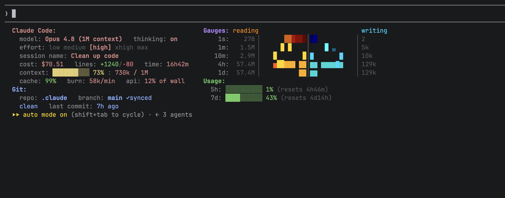
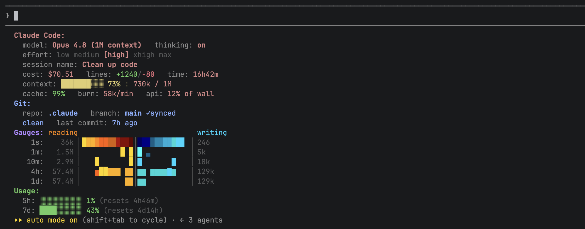

# revline

A rich, single-file status line for [Claude Code](https://claude.com/claude-code) — your model, cost, git state, and a live **read/write "mirror"** that charts the tokens the model reads vs writes over time, rendered right in the terminal footer. Zero dependencies, one Python file, drops in with three lines of config.



_The **mirror** splits each row down the middle: tokens **read** (input, warm) fill the left half from the center, tokens **written** (output, cool) fill the right — newest at the center, five timescales stacked (`1s` → `1d`)._

## Why

Claude Code's built-in footer is a single line. When you're deep in a long session you often want more at a glance: how full is the context window, what has this session cost, what's my git state, and — the fun part — how much the model is reading and writing right now. `revline` puts all of that in a compact, color-coded dashboard, and it's a single self-contained script you can read top to bottom and trust.

## Features

- **Four sections, color-grouped by system** — Claude Code (model · thinking · effort · session · cost · context · cache/burn/api), Git (repo · branch · ahead/behind · PR · dirty count · last-commit age), Gauges (the read/write mirror), Usage (rate-limit budgets).
- **The read/write "mirror"** — a butterfly chart of tokens **read** (input, incl. cache) vs **written** (output) over time. Reading is warm and fills the left half from the center outward; writing is cool and fills the right. Newest is at the center, oldest at the outer edges, with the reading and writing totals flanking each row.
- **Five timescales** — `1s` is a live, EMA-smoothed tachometer of the current rate; `1m / 10m / 4h / 1d` are history. Both bar height and hue rise with throughput.
- **One scale for the whole mirror** — every row (the live `1s` tach and the `1m / 10m / 4h / 1d` history) plots throughput _rate_ against the same fixed reference, so a response streams in at the center of each row just like the needle, the same rate always looks the same, and nothing strobes as the window slides.
- **Two layouts, toggled live** — `vertical` (stacked) or `horizontal` (two aligned columns), switched with `revline flip` without restarting.
- **Clickable git links** — repo and PR are OSC-8 hyperlinks in terminals that support them.
- **Never crashes your footer** — any malformed input prints nothing and exits cleanly, rather than leaking a traceback.
- **Zero dependencies** — Python 3 standard library only. No `pip install`.

## Requirements

- **Python 3** (standard library only — no third-party packages).
- A terminal with 256-color / truecolor support (most modern terminals: iTerm2, WezTerm, VS Code, the JetBrains terminal, Windows Terminal). OSC-8 links are an optional nicety that degrades gracefully where unsupported.

## Install

1. **Save the script** somewhere stable and make it executable:

   ```sh
   curl -o ~/.claude/revline.py https://raw.githubusercontent.com/hawkesj12/revline/main/revline.py
   chmod +x ~/.claude/revline.py
   ```

2. **Point Claude Code at it** in `~/.claude/settings.json`:

   ```json
   {
     "statusLine": {
       "type": "command",
       "command": "~/.claude/revline.py",
       "padding": 0,
       "refreshInterval": 1
     }
   }
   ```

3. **Start a session.** The footer picks it up — no restart of anything else needed.

That's the whole install. Claude Code runs the command each refresh and pipes it the session JSON on stdin; `revline` reads that and prints the dashboard. It never makes a network call and costs zero API tokens (the status line is never sent to the model).

### Optional: the `revline` command

To control the layout from the terminal, put the script on your `PATH`:

```sh
ln -s ~/.claude/revline.py ~/.local/bin/revline   # any dir on your PATH
```

## Layout

`revline` renders in one of two orientations.

**vertical** _(default)_ — all four sections stacked:



**horizontal** — Claude Code + Git on the left, Gauges + Usage on the right, in two aligned columns. Good for a wide, short footer (shown at the top of this README).

Switch layouts from the terminal (takes effect on the next render, ~1s — no restart):

```sh
revline flip     # toggle H <-> V
revline H        # horizontal
revline V        # vertical
revline help     # usage
```

## Configuration

Orientation is resolved in this order:

1. **`revline.config.json`** next to the script — written by the commands above, e.g. `{"layout": "H"}` (`H` or `V`).
2. **`CC_STATUSLINE_LAYOUT`** environment variable (`H` / `V` / `horizontal` / `vertical`) — a fallback if you'd rather set it declaratively.
3. **Default:** vertical.

## What the mirror measures (read this before trusting the numbers)

Each response, Claude Code reports how many tokens it **read** (input — mostly prompt-cache reads) and **wrote** (output). revline accumulates those per-response counts (they're per-response snapshots in the JSON, not cumulative) and charts reading vs writing over five timescales. **Reading dwarfs writing (~100×)** because every turn re-reads the whole context. This is a **throughput / activity** view, not a billing figure — most reading is cache (billed at a fraction of fresh input). For spend, watch the `cost: $…` line (Claude Code's own estimate) and the `cache:` hit-ratio. Tokens ≈ activity, `$` ≈ cost.

## Platform notes

Developed and used on macOS. It uses only portable standard-library calls (`tempfile.gettempdir()` for its small state files, no POSIX-only APIs), so it should run on Linux and Windows as well — but Windows hasn't been verified yet. Reports welcome.

## Contributing

Issues and PRs welcome — open an issue first to talk it through. It's one file by design; the goal is to keep it self-contained and dependency-free.

## License

[MIT](LICENSE) © 2026 Justin Hawkes
